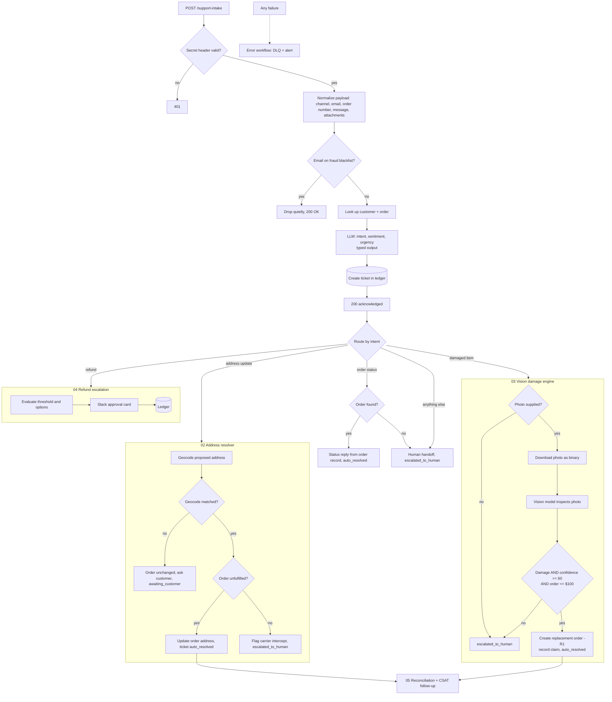

# Case Study: Omnichannel Customer Operations Automation

**An e-commerce support back office as chained n8n workflows: it screens fraud, understands what each customer wants, fixes addresses, judges damage claims from photos, and sends only the expensive decisions to a human.**

    

| | |
|---|---|
| **Type** | Portfolio build (reference implementation for a fictional home-goods store, not a client engagement) |
| **My role** | Sole designer and builder: routing design, prompt and schema design, data model, escalation policy |
| **Scale** | 6 workflows, 66 nodes, 5 Supabase tables, intake plus 3 specialist flows plus reconciliation |
| **Core vs extension** | The core flow is workflows 01-03 (intake and routing, address resolver, damage engine). 04 (refund escalation) and 05 (reconciliation) extend it. |
| **Stack** | n8n, OpenRouter (text and vision models), Supabase, Airtable, Slack API, OpenStreetMap Nominatim |
| **Status** | Portfolio build. Runs on sample data and seeded orders, not real customers. |

---

## The problem

Most support tickets in a small online store are routine and repetitive: "where is my order", "I typo'd my apartment number", "my item arrived broken". Each one costs an agent several minutes of lookups across the order system, the customer record and the carrier, even though the right answer is usually obvious. At the same time, a few tickets are dangerous: fraudulent accounts, large refunds, angry high-value customers. Those need judgement and accountability.

The goal is not to remove humans. It is to make sure **people only spend time on the tickets where their judgement is worth the cost**, and to make that boundary explicit.

## Outcome

- Every inquiry is authenticated, screened against a fraud list, matched to the customer and order, classified by intent and sentiment, and logged as a ticket, before a person sees it.
- **Address changes** on unfulfilled orders are applied automatically; shipped orders are flagged for a carrier intercept instead.
- **Damage claims** are inspected by a vision model. Clear, low-value cases get an automatic replacement order; everything else is escalated with the evidence attached.
- **Refunds over a threshold** go to a Slack approval card with options, and nothing is paid out until a person clicks.
- Every action is written to a **ticket ledger**, then reconciled into an operations view.

---

## Architecture



### Stage by stage

| # | Workflow | What it does | Why it is built this way |
|---|---|---|---|
| 01 | **Intake and LTV matcher** | Validates a secret header, normalises the payload (channel, email, order number found in the message if not supplied, attachment flag), checks the fraud blacklist, loads customer and order, classifies intent and sentiment, writes a ticket (the number comes from a database sequence), acknowledges, routes. Order-status questions get a reply built from the order record; everything with no automated handler is handed to a person. | Cheap, deterministic checks run first; the LLM runs only for legitimate traffic. |
| 02 | **Address resolver** | Builds the proposed address from the customer's correction and geocodes it through Nominatim (city, state and ZIP only, not the street). A failed or empty match leaves the order unchanged and asks the customer to confirm; otherwise it branches on fulfilment status. | Changing an address on a shipped order is not an edit, it is a carrier problem, so the workflow treats the two cases differently. |
| 03 | **Vision damage engine** | Escalates straight away if there is no photo; otherwise downloads the photo, sends it to a pinned vision model as image data, and gets typed findings against a severity rubric. A three-part rule decides replace or escalate. | Only unambiguous, cheap cases are automated; ambiguity is a human's job. |
| 04 | **High-value escalation** | Computes the reason for escalation and the options (including store credit at 120% of order value) and posts a Slack approval card. | Money decisions above a threshold need a named human. |
| 05 | **Reconciliation** | Records resolution metrics (measured time from ticket creation to resolution) and a CSAT follow-up into an operations hub. | Automation needs a feedback loop or nobody knows whether it is working. |
| - | **Error handler** | Logs failures to a dead-letter table and alerts DevOps. | Unattended systems must say when they break. |

---

## Deep dives

### The intake classifier

Intent is a closed set so it can be routed on:

```jsonc
{
  "intent":    "ADDRESS_UPDATE | DAMAGED_ITEM | ORDER_STATUS | REFUND_REQUEST | GENERAL_INQUIRY",
  "sentiment": "satisfied | neutral | frustrated | hostile",
  "urgency":   "low | medium | high | critical",
  "extracted_address_correction": "string or null",
  "reasoning": "short justification"
}
```

The prompt supplies the order and customer record alongside the message, so "where is my package" is judged against the real order state. The classifier also extracts the corrected address (for example "Apt 4B") so the next workflow does not need a second model call.

### The fast path is a policy, not a prompt

The vision model returns `damage_detected`, `damage_severity` (`minor`, `moderate`, `catastrophic`, `no_damage`), `confidence_score` (0-100), an item description and its reasoning. Then an IF node, not the model, decides:

```
damage_detected == true
AND confidence_score >= 60
AND order_value <= 100
```

If all three hold, the workflow creates a replacement order (the original order number with an `-R1` suffix), records the claim, marks the ticket `auto_resolved` and tells the customer. Otherwise the ticket becomes `escalated_to_human` and the customer is told a person is reviewing it. The model supplies evidence; policy stays in logic I can read, tune and defend.

### Address resolution that knows what it cannot undo

The same customer request ("change my apartment number") means two different things depending on one fact. If the order is still `unfulfilled`, the shipping address is updated in the order table and the ticket is auto-resolved. If it has shipped, the workflow records a carrier intercept request, marks the ticket for a human and sends a different message. Treating them as one case would silently promise something the warehouse can no longer deliver.

### Why the ledger matters

Every workflow writes its outcome back to `support_tickets` with a status (`auto_resolved`, `escalated_to_human`), the action executed and a resolution time. That makes the system reviewable after the fact: how many tickets did automation close, which ones went to humans and why. Without a ledger, automation is a black box and nobody will trust it.

---

## Decision log

### Decision 1: fraud check before enrichment and before the LLM
- Blacklisted senders are dropped with a quiet `200`, so an attacker learns nothing and the system spends nothing. Cost: a lookup on every request.

### Decision 2: route on a closed intent set
- Closed enums mean a Switch can route deterministically. Cost: a new kind of request needs a new intent and a new branch. Anything with no automated handler goes to a person.

### Decision 3: policy in logic, evidence from the model
- Applied to the fast path and to the refund threshold. The model never holds the authority to spend money.

### Decision 4: separate workflows per specialist
- Independent testing and change. Cost: Execute Workflow links to maintain (placeholders in this export).

### Decision 5: acknowledge after the ticket exists
- The caller gets a `200` only once the ticket is recorded, so "accepted" means "will not be lost".

---

## Failure modes I designed for

| What goes wrong | What happens |
|---|---|
| Bad or missing secret | `401`, nothing else runs |
| Blacklisted customer | Dropped quietly, no lookups, no LLM cost |
| Order already shipped | Address change becomes a carrier-intercept request for a human |
| Address cannot be geocoded | Order left unchanged, ticket marked `awaiting_customer`, customer asked to confirm |
| Damage claim with no photo | Escalated for human review, no model call |
| Order-status request for an unknown order, or any other intent | Handed to a person, ticket `escalated_to_human` |
| Damage claim is ambiguous or high value | Escalated with the model's reasoning, never auto-approved |
| Any refund request | Slack approval card stating the reason (over $100, or a frustrated or hostile customer); no automatic payout |
| Any workflow throws | Error workflow logs it and alerts DevOps |

## Data model

| Table | Purpose |
|---|---|
| `support_customers` | Customer profile: email, name, lifetime value tier, spend, order count |
| `support_orders` | Order number, status (`unfulfilled`, shipped), shipping address, carrier, tracking, total |
| `support_tickets` | The ledger: ticket number, intent, sentiment, status, action executed, resolution time |
| `support_damage_claims` | Claim record: ticket, order, severity, confidence, reasoning |
| `support_fraud_blacklist` | `email_or_phone` entries to drop on sight |

Airtable holds the operations hub and the dead-letter table.

## Testing and verification

**Vision input.** The vision step was checked by hand against real photos using the workflow's prompt, rubric and credential. It is a small manual check, not an accuracy measurement. Sent as remote URLs, the provider's answers on the same photos were inconsistent; sent inline as base64 data, every answer was correct (a chipped teapot lid and a hairline-cracked mug were both reported as `damage_detected`, `moderate`, with the crack described correctly). That is why workflow 03 downloads the photo first and sends it as image data to a pinned model.

**Live runs through the intake webhook** on seeded orders, with the ticket rows read back afterwards:

| Case | Result |
|---|---|
| Order-status question, unfulfilled order | Ticket `auto_resolved`, `order_status_reply_prepared`, 0 s |
| Address correction ("Apt 4B"), unfulfilled order | Geocoder matched, order updated, ticket `auto_resolved`, 1 s |
| Damage claim with no photo | `escalated_for_human_review`, reason "no photo supplied" |
| General question (shipping and returns) | `human_handoff`, ticket `escalated_to_human` |
| Damage claim with a photo of blister packs | Photo downloaded (79 KB JPEG), sent as binary to the pinned model; `no_damage` at 98 confidence; escalated to a person |

**Measured run on 100 labeled synthetic tickets.** Every ticket has an expected intent, status and action, and the score is computed. Intent was correct on 93 of 93 created tickets, and the final status and action matched on 90 of 93 (97%). Nothing was auto-resolved that a person should have seen, all 5 fraud-listed senders were dropped, both wrong-secret requests got a `401`, and 11 of 12 damage photos ended in the right outcome. The misses and limits are real: two address tickets hit the geocoder's timeout (one should have been a carrier intercept), one photo was judged "no damage", and acknowledgement took about 26 s on a self-hosted CPU model. Method, full results and limits are in [`test/`](test/README.md). The messages are templated and the photos are free-licence images of broken dishware, so treat the figures as a regression baseline, not a production accuracy claim.

Resolution time is measured from ticket creation to resolution. The sample payload is at [`samples/support-intake.json`](samples/support-intake.json). Cases worth running yourself: a damage claim under $100 (should replace), the same claim over $100 (should escalate), an address change on a shipped order, a blacklisted email, a wrong secret.

## Configuration and swap-ins

Everything below is a setting or a node swap, not a rewrite. The defaults are what I used because they are free or cheapest, not because the design needs them.

| What | Default here | Change it to |
|---|---|---|
| **Intent LLM** | OpenRouter free router | Any chat model. |
| **Vision model** | Pinned `google/gemini-2.5-flash` via OpenRouter, 800-token output cap | Any vision-capable model (GPT-4o class, Claude, Gemini, a local LLaVA-style model). Pin one specific model for consistent results, and re-check it is still served: my first pin was retired by the provider. |
| **Fast-path rule** | Damage detected, confidence at least 60, order value at most $100 | Any thresholds, or add conditions such as customer tier or number of prior claims. One IF node. |
| **Refund escalation** | Above $100, or a frustrated or hostile customer | Any threshold. Store credit is offered at 120% of order value; change the multiplier. |
| **Fraud list** | Supabase table | Any lookup, or a fraud service API. |
| **Geocoder** | OpenStreetMap Nominatim | Google, Mapbox, Smarty, Loqate. |
| **Database** | Supabase | Postgres, Airtable, MySQL. |
| **Approvals** | Slack | Discord, Teams, email. |
| **Store, products and notice text** | Fictional home-goods brand | Your own brand, policies and wording. |
| **Intents** | Five | Add intents and routes (for example subscription changes). |

## What this demonstrates

- **Policy-as-logic around an LLM**: explicit thresholds govern anything that moves money.
- **Multi-modal AI** used as an evidence source, with a typed schema, confidence scoring and a hands-on test of where it fails.
- **Defensive intake design**: authentication, fraud screening, early acknowledgement.
- **Modular orchestration** across a relational ledger, geocoding, chat approvals and an operations hub.
- **Auditability**: a ticket ledger recording what the system did and why.

## Repository

| File | Purpose |
|---|---|
| [`workflows/01-omnichannel-intake-ltv-matcher.json`](workflows/01-omnichannel-intake-ltv-matcher.json) | Intake, auth, fraud check, enrichment, classification, routing |
| [`workflows/02-logistics-address-resolver.json`](workflows/02-logistics-address-resolver.json) | Address validation, update or carrier intercept |
| [`workflows/03-vision-damage-warranty-engine.json`](workflows/03-vision-damage-warranty-engine.json) | Vision inspection, fast-path replacement or escalation |
| [`workflows/04-financial-escalation-slack-hitl.json`](workflows/04-financial-escalation-slack-hitl.json) | Refund threshold, options, Slack approval card |
| [`workflows/05-ops-reconciliation-csat.json`](workflows/05-ops-reconciliation-csat.json) | Resolution metrics and CSAT follow-up |
| [`workflows/06-error-handler-dlq.json`](workflows/06-error-handler-dlq.json) | Global error handler |
| [`samples/support-intake.json`](samples/support-intake.json) | Sample request payload |
| [`sql/ticket-number-sequence.sql`](sql/ticket-number-sequence.sql) | Sequence and default for ticket numbers |

### Run it yourself
1. Import the six workflows into n8n. All are exported **inactive**.
2. Replace every placeholder (`REPLACE_ME`, `YOUR_*`, `WORKFLOW_ID_*`), re-select credentials, and re-link the Execute Workflow nodes and the Error workflow setting to your imported copies.
3. Create the five Supabase tables, then run [`sql/ticket-number-sequence.sql`](sql/ticket-number-sequence.sql) for sequential ticket numbers. Create the Airtable operations hub, and a Header Auth credential for the Slack bot token (`Authorization: Bearer ...`). Add an interactions-router workflow that handles the Slack button actions (`lumina_refund_full`, `lumina_credit_120`); this repo posts the approval card, and the click is handled outside it.
4. Edit the sample so `attachments` holds a public image URL (the placeholder in it does not resolve), then send it:

   ```bash
   curl -X POST https://YOUR-N8N-HOST/webhook/support-intake \
     -H "X-Intake-Secret: YOUR_SHARED_SECRET" \
     -H "Content-Type: application/json" \
     -d @samples/support-intake.json
   ```

Brand names, people and addresses are fictional demo data. MIT licensed.
